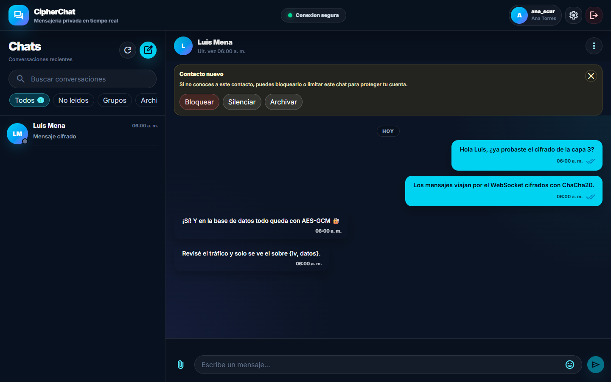
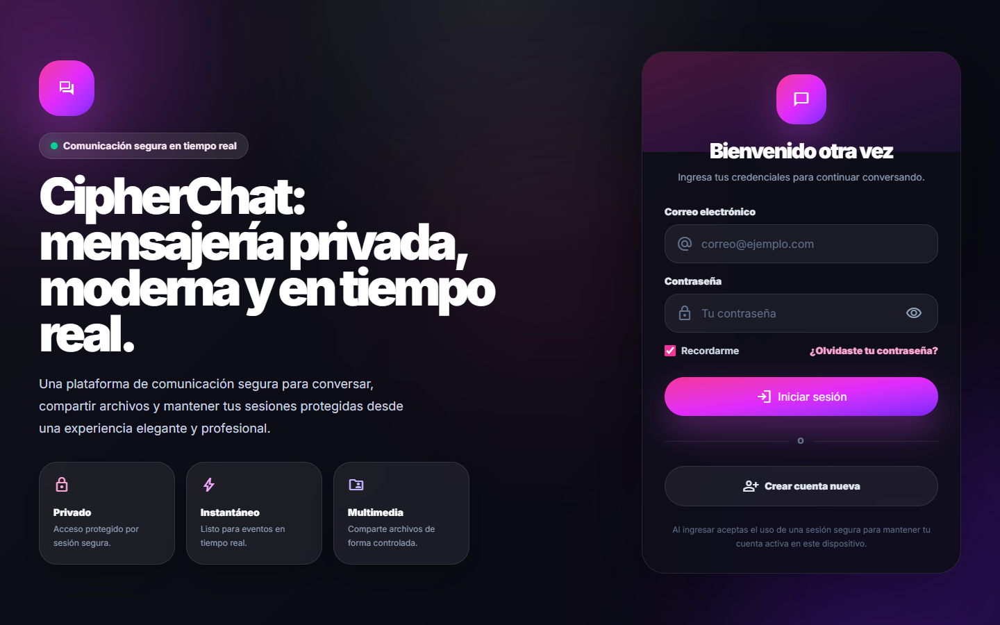
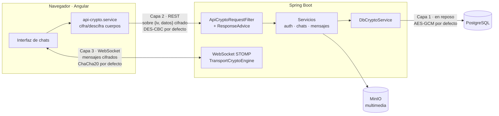

# CipherChat · mensajería con cifrado en tres capas

<p>
  
  
  
  
  
</p>

Aplicación de mensajería al estilo WhatsApp construida para la asignatura de **Seguridad**: chats
individuales y grupales, multimedia, reacciones, respuestas, ubicación, presencia en tiempo real y
sesiones por dispositivo, con **cifrado simétrico configurable en tres capas** para comparar AES-GCM,
DES-CBC y ChaCha20-Poly1305 en un sistema real.



| Inicio de sesión |
|---|
|  |

<sub>Capturas del stack levantado con `docker compose`, con dos usuarios ficticios creados desde la interfaz.</sub>

## Las tres capas de cifrado



| Capa | Qué protege | Algoritmo por defecto | Variables |
|---|---|---|---|
| 1 · Base de datos | Contenido sensible guardado en PostgreSQL | AES-GCM | `MESSENGER_DB_CRYPTO_ALGORITHM`, `MESSENGER_DB_CRYPTO_SECRET` |
| 2 · API REST | Cuerpo de cada petición y respuesta entre Angular y Spring | DES-CBC | `MESSENGER_API_CRYPTO_ALGORITHM`, `MESSENGER_API_CRYPTO_SECRET` |
| 3 · WebSocket | Mensajes y eventos de presencia por STOMP | ChaCha20 | `MESSENGER_WS_CRYPTO_ALGORITHM`, `MESSENGER_WS_CRYPTO_SECRET` |

Cada capa acepta `AES_GCM`, `DES_CBC` o `CHACHA20` (`CHACHA20_POLY1305` en la base) y se cambia solo con
variables de entorno. Las capas 2 y 3 usan una clave compartida que debe ser la misma en backend y frontend.

> DES-CBC está incluido para comparar: es un algoritmo obsoleto (clave efectiva de 56 bits) y no debe usarse
> fuera de un contexto académico.

## Funcionalidades

- **Cuentas:** registro, inicio de sesión con token por dispositivo, cierre de sesión en uno o en todos los
  dispositivos, recuperación de contraseña por correo.
- **Perfil y privacidad:** avatar, biografía, visibilidad del «último visto», bloqueo de usuarios.
- **Chats:** individuales y grupales con roles, miembros, archivado y silenciado.
- **Mensajes:** texto, imágenes, audio, archivos y ubicación; edición, borrado para mí o para todos,
  respuestas, reacciones con emoji y estados de entrega y lectura.
- **Tiempo real:** mensajes nuevos, «escribiendo…» y presencia por WebSocket (STOMP + SockJS).
- **Multimedia:** en MinIO, servida con URL prefirmadas que vencen en 24 horas.

## Inicio rápido

```bash
cp .env.example .env        # y reemplace los secretos de ejemplo
docker compose up -d --build
```

| Servicio | Dirección |
|---|---|
| Aplicación | <http://localhost:4200> |
| API + Swagger | <http://localhost:8080/swagger-ui.html> |
| Consola de MinIO | <http://localhost:9001> |

El stack levanta PostgreSQL, MinIO (detrás de un nginx que mantiene la firma S3), el backend y el frontend.
Para Railway hay un `Dockerfile` de **imagen única** en la raíz (nginx + Spring Boot + MinIO con
supervisord).

> MinIO dejó de publicar imágenes y binarios gratuitos en 2025. El proyecto usa el fork comunitario
> `pgsty/minio`, fijado a un release, con el mismo binario y la misma API S3.

## API

| Área | Endpoints principales |
|---|---|
| Autenticación | `POST /auth/login` · `POST /auth/logout` · `POST /auth/logout-all` · `GET /auth/sesiones` |
| Usuarios | `POST /usuarios/registro` · `GET/PATCH /usuarios/me` · `GET /usuarios/buscar` · bloqueos |
| Chats | `POST /chats/individual` · `POST /chats/grupo` · `GET /chats` · configuración y miembros |
| Mensajes | `GET/POST /chats/{id}/mensajes` · editar · borrar · reacciones |
| Archivos | `GET /archivos/**` → redirección a URL prefirmada de MinIO |
| STOMP | `/app/escribiendo` · `/app/dejo-de-escribir` |

El detalle completo (entidades, servicios y endpoints) está en
[`ProyectoSeguridadBackend/ESTADO_PROYECTO.md`](ProyectoSeguridadBackend/ESTADO_PROYECTO.md).

## Estructura

```
├── ProyectoSeguridadBackend/    Spring Boot (Java 21): auth, usuarios, chats, mensajes, crypto, websocket
├── ProyectoSeguridadFrontend/   Angular: features auth, chats y users
├── docker-compose.yml           Stack completo para desarrollo
├── Dockerfile                   Imagen única para Railway
└── .env.example                 Variables y secretos de las tres capas
```

## Historial

El backend y el frontend se desarrollaron primero en repositorios separados, con una rama y un pull
request por funcionalidad (usuarios, chats, login). Este repositorio reúne la versión final de ambos.
